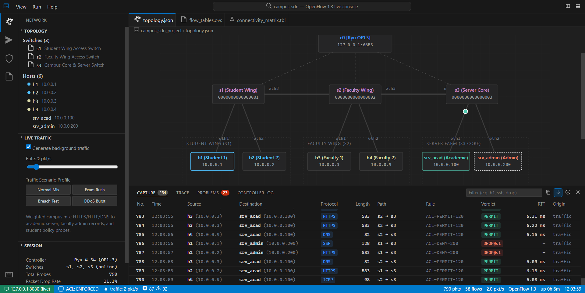
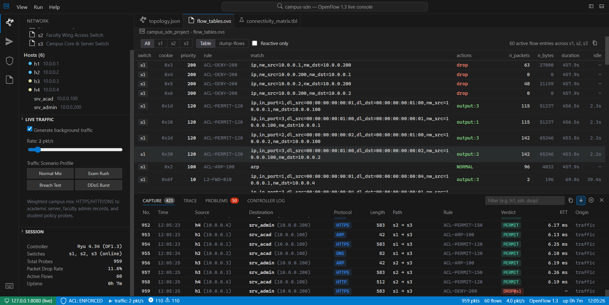
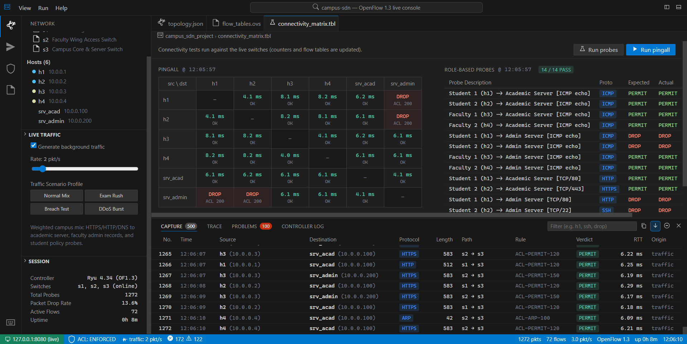
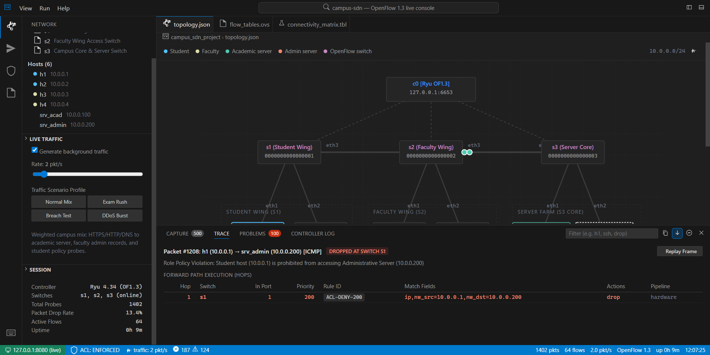
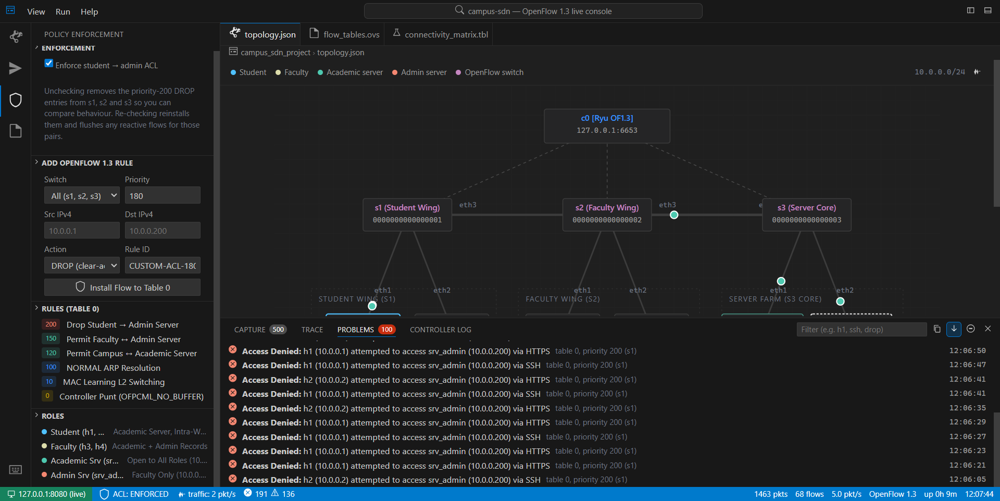
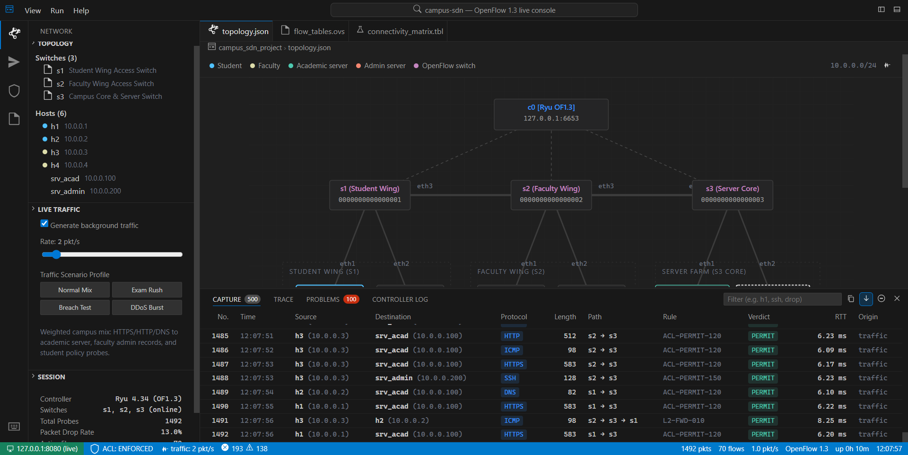
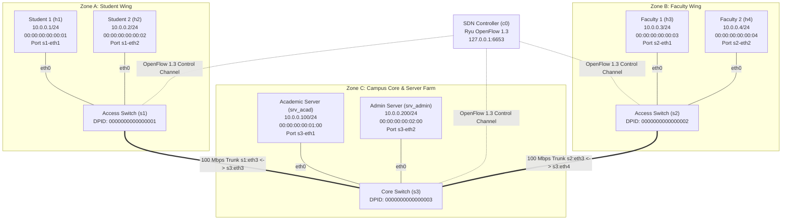
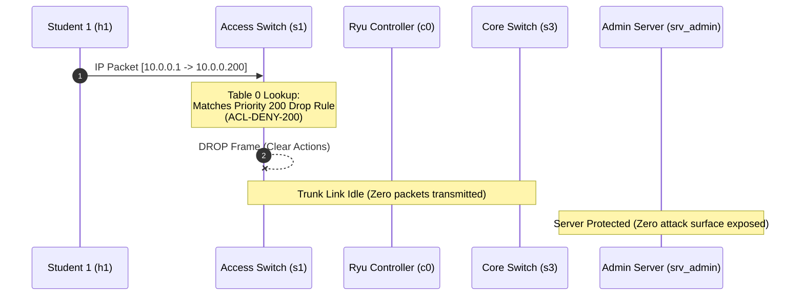
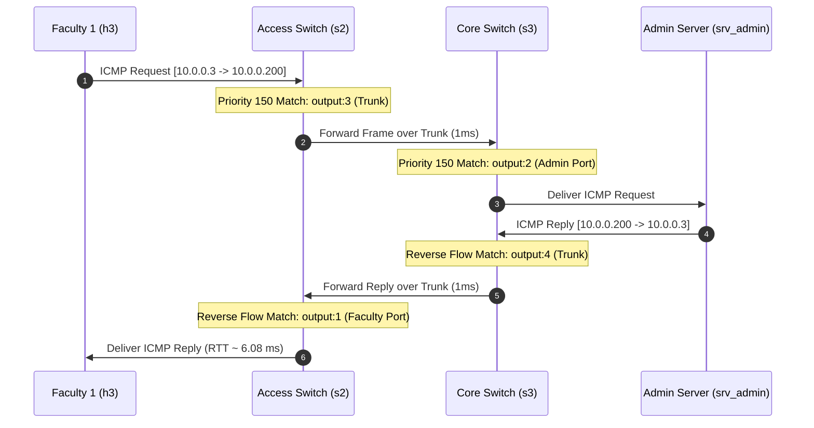

# Campus Access Control via OpenFlow 1.3 Software-Defined Networking (SDN)

[](https://github.com/Rahulchaube1/sdnproject/actions/workflows/ci.yml)
[](https://sdnproject.vercel.app)
[](https://github.com/Rahulchaube1/sdnproject/releases)
[](LICENSE)


> **Live Deployment:** [https://sdnproject.vercel.app](https://sdnproject.vercel.app)  
> **Source Repository:** [https://github.com/Rahulchaube1/sdnproject](https://github.com/Rahulchaube1/sdnproject)

---

## Live Console & Operational Telemetry

The workbench provides an interactive VS Code "Dark Modern" reactive telemetry console connecting directly to the OpenFlow 1.3 control plane over Server-Sent Events (SSE).

| Interactive SDN Topology & Live Counters | OpenFlow 1.3 Flow Tables Inspector |
| :---: | :---: |
|  |  |

| 30-Pair PingAll Matrix & 14 Compliance Probes | Hop-by-Hop Packet Pipeline Trace |
| :---: | :---: |
|  |  |

| Policy Enforcement & Real-Time Problems View | Real-Time Packet Stream & CSV Capture Export |
| :---: | :---: |
|  |  |

---

## Academic Project Information

- **Institution:** Department of Networking and Communications, SRM Institute of Science and Technology
- **Course / Project:** Software-Defined Networking (OpenFlow 1.3 Architecture & Access Control)
- **Project Team:**
  - **Rahul Chaube** (`RA2311003012372`)
  - **Mayank Shah** (`RA2311003012388`)
  - **Neha Mallik** (`RA2311003012393`)
- **Primary Repository:** [https://github.com/Rahulchaube1/sdnproject](https://github.com/Rahulchaube1/sdnproject)

---

## 1. Executive Summary & Problem Statement

Modern higher-education campus networks support thousands of concurrent endpoints across distinct administrative security domains: undergraduate and postgraduate students, faculty and researchers, departmental administrative staff, and central IT server farms.

Traditional legacy campus networks rely on distributed Layer-2 VLAN trunks, 802.1Q tagging, and static Access Control Lists (ACLs) configured hop-by-hop on access, distribution, and core chassis switches. This approach suffers from:
1. **Configuration Drift & Human Error:** Distributed ACLs on heterogeneous switch operating systems frequently desynchronize.
2. **Subnet Inelasticity:** Re-assigning host roles often demands physical port re-patching or complex 802.1X VLAN steering.
3. **Inefficient Core Hairpinning:** Filtering rules deployed at core firewalls force unauthorized packets to traverse access and aggregation links before being dropped, consuming valuable campus trunk bandwidth.

### The SDN Solution
This project deploys a centralized **Software-Defined Networking (SDN)** architecture using **OpenFlow 1.3** and the **Ryu SDN Controller Framework**. Access policies are enforced directly at the **first-hop ingress OpenFlow switches** (`s1`, `s2`) and core aggregation switch (`s3`). Unauthorized frames (e.g., student traffic bound for administrative servers) are dropped proactively in hardware flow tables before crossing any inter-switch trunk links, protecting campus infrastructure from unauthorized lateral movement and denial-of-service risks.

---

## 2. Campus Network Topology & Addressing Plan

The campus data plane is structured into three distinct physical and logical zones connected over high-speed trunk links within the subnet `10.0.0.0/24`.



### Detailed Infrastructure Specification

| Entity | Role / Description | IP / CIDR | MAC Address | Connected Switch & Port | OpenFlow DPID |
| :--- | :--- | :--- | :--- | :--- | :--- |
| **`c0`** | Central Ryu SDN Controller | `127.0.0.1:6653` | N/A (Control Plane) | Out-of-Band TCP Control | N/A |
| **`s1`** | Student Wing Access Switch | N/A (L2 Datapath) | Switch Datapath | `s1-eth3` ↔ `s3-eth3` | `0000000000000001` |
| **`s2`** | Faculty Wing Access Switch | N/A (L2 Datapath) | Switch Datapath | `s2-eth3` ↔ `s3-eth4` | `0000000000000002` |
| **`s3`** | Core Server Aggregation Switch | N/A (L2 Datapath) | Switch Datapath | `s3-eth1..4` | `0000000000000003` |
| **`h1`** | Student Workstation 1 | `10.0.0.1/24` | `00:00:00:00:00:01` | `s1-eth1` | Host Endpoint |
| **`h2`** | Student Workstation 2 | `10.0.0.2/24` | `00:00:00:00:00:02` | `s1-eth2` | Host Endpoint |
| **`h3`** | Faculty Laptop 1 | `10.0.0.3/24` | `00:00:00:00:00:03` | `s2-eth1` | Host Endpoint |
| **`h4`** | Faculty Laptop 2 | `10.0.0.4/24` | `00:00:00:00:00:04` | `s2-eth2` | Host Endpoint |
| **`srv_acad`** | Academic Portal Server | `10.0.0.100/24` | `00:00:00:00:01:00` | `s3-eth1` | Server Endpoint |
| **`srv_admin`**| Administrative Records Server | `10.0.0.200/24` | `00:00:00:00:02:00` | `s3-eth2` | Server Endpoint |

---

## 3. Role-Based Access Control (RBAC) Security Policy

The university security policy establishes role separation between undergraduate student endpoints and sensitive staff administration systems:

1. **Academic Server Access (`srv_acad` @ `10.0.0.100`):**
   - **Policy:** Universally accessible by **all campus roles** (Students `h1`, `h2` and Faculty `h3`, `h4`).
   - **Services:** HTTP (TCP/80), HTTPS (TCP/443), LMS APIs, ICMP diagnostic echoes.
2. **Administrative Server Access (`srv_admin` @ `10.0.0.200`):**
   - **Policy:** **Strictly restricted to Faculty members (`h3`, `h4`)**.
   - **Enforcement:** All frames originating from or destined to Student hosts (`h1`, `h2`) are **DROPPED at first-hop switch ingress** (`s1`).
   - **Services:** Management SSH (TCP/22), Admin HTTP records portal (TCP/80).
3. **Peer-to-Peer Campus Forwarding:**
   - Permitted between peers within the campus domain for legitimate research, collaborative learning, and address resolution (ARP).

### Directional Policy Decision Matrix

| Source Endpoint | Destination Endpoint | Traffic Type | Verdict | Enforcing Switch & Action | Security Justification |
| :--- | :--- | :--- | :--- | :--- | :--- |
| `h1` (Student 1) | `srv_acad` (10.0.0.100) | ICMP / HTTP / HTTPS | **PERMIT** | Forwarded via `s1` → `s3` (Priority 120) | Open Academic Resource |
| `h2` (Student 2) | `srv_acad` (10.0.0.100) | ICMP / HTTP / HTTPS | **PERMIT** | Forwarded via `s1` → `s3` (Priority 120) | Open Academic Resource |
| `h3` (Faculty 1) | `srv_acad` (10.0.0.100) | ICMP / HTTP / HTTPS | **PERMIT** | Forwarded via `s2` → `s3` (Priority 120) | Open Academic Resource |
| `h4` (Faculty 2) | `srv_acad` (10.0.0.100) | ICMP / HTTP / HTTPS | **PERMIT** | Forwarded via `s2` → `s3` (Priority 120) | Open Academic Resource |
| `h1` (Student 1) | `srv_admin` (10.0.0.200) | ICMP / HTTP / SSH | **DROP** | **Ingress Drop at `s1`** (Priority 200) | Unauthorized role access |
| `h2` (Student 2) | `srv_admin` (10.0.0.200) | ICMP / HTTP / SSH | **DROP** | **Ingress Drop at `s1`** (Priority 200) | Unauthorized role access |
| `h3` (Faculty 1) | `srv_admin` (10.0.0.200) | ICMP / HTTP / SSH | **PERMIT** | Forwarded via `s2` → `s3` (Priority 150) | Authorized Faculty role |
| `h4` (Faculty 2) | `srv_admin` (10.0.0.200) | ICMP / HTTP / SSH | **PERMIT** | Forwarded via `s2` → `s3` (Priority 150) | Authorized Faculty role |
| `h1` (Student 1) | `h2` (Student 2) | ICMP / TCP | **PERMIT** | Local switching at `s1` (Priority 10) | Intra-subnet peer communication |
| `srv_admin` | `h1` (Student 1) | Any Protocol | **DROP** | Ingress Drop at `s3` (Priority 200) | Reverse isolation enforcement |

---

## 4. OpenFlow 1.3 Datapath Pipeline Architecture

The OpenFlow 1.3 switch pipeline executes inside hardware Table 0 on each switch (`s1`, `s2`, `s3`). When a packet arrives, Table 0 evaluates match criteria in order of **descending priority**:

```
+-------------------------------------------------------------------------------+
|                        OpenFlow 1.3 Table 0 Pipeline                          |
+-------------------------------------------------------------------------------+
| Priority 200: Proactive Role Drop                                            |
| Match: eth_type=0x0800, ipv4_src=10.0.0.1/2, ipv4_dst=10.0.0.200             |
| Match: eth_type=0x0800, ipv4_src=10.0.0.200,   ipv4_dst=10.0.0.1/2             |
| Action: CLEAR_ACTIONS (Hardware Drop)                                         |
+-------------------------------------------------------------------------------+
                                     | No match
                                     v
+-------------------------------------------------------------------------------+
| Priority 150: Faculty <-> Admin Server Flow                                   |
| Match: eth_type=0x0800, ipv4_src=10.0.0.3/4, ipv4_dst=10.0.0.200             |
| Action: OUTPUT:<egress_port> (idle_timeout=60s)                               |
+-------------------------------------------------------------------------------+
                                     | No match
                                     v
+-------------------------------------------------------------------------------+
| Priority 120: Campus <-> Academic Server Flow                                 |
| Match: eth_type=0x0800, ipv4_src=10.0.0.1..4, ipv4_dst=10.0.0.100            |
| Action: OUTPUT:<egress_port> (idle_timeout=60s)                               |
+-------------------------------------------------------------------------------+
                                     | No match
                                     v
+-------------------------------------------------------------------------------+
| Priority 100: ARP Address Resolution                                          |
| Match: eth_type=0x0806 (ARP)                                                  |
| Action: OUTPUT:NORMAL (Subnet Broadcast)                                      |
+-------------------------------------------------------------------------------+
                                     | No match
                                     v
+-------------------------------------------------------------------------------+
| Priority 10: Standard L2 Forwarding (Learned MACs)                            |
| Match: in_port, dl_src, dl_dst                                                |
| Action: OUTPUT:<learned_port>                                                 |
+-------------------------------------------------------------------------------+
                                     | No match
                                     v
+-------------------------------------------------------------------------------+
| Priority 0: Table-Miss Flow Entry (Proactive Default)                         |
| Match: * (Wildcard Any)                                                       |
| Action: OUTPUT:CONTROLLER (buffer_id=OFPCML_NO_BUFFER)                         |
+-------------------------------------------------------------------------------+
```

### Flow Entry Specification Table

| Priority | Match Fields (`OFPMatch`) | Actions (`OFPInstructionActions`) | Timeout | Rule ID | Type | Purpose |
| :---: | :--- | :--- | :---: | :--- | :---: | :--- |
| **`200`** | `eth_type=0x0800, nw_src=10.0.0.1, nw_dst=10.0.0.200`<br>`eth_type=0x0800, nw_src=10.0.0.2, nw_dst=10.0.0.200`<br>`eth_type=0x0800, nw_src=10.0.0.200, nw_dst=10.0.0.1/2` | `drop` (empty action list) | Permanent (`0`) | `ACL-DENY-200` | Proactive | Drops Student traffic to Admin Server at ingress switch |
| **`150`** | `eth_type=0x0800, nw_src=10.0.0.3/4, nw_dst=10.0.0.200` | `output:<port>` | `idle=60s` | `ACL-PERMIT-150` | Reactive / Proactive | Authorizes Faculty access to Admin Server |
| **`120`** | `eth_type=0x0800, nw_src=10.0.0.1..4, nw_dst=10.0.0.100` | `output:<port>` | `idle=60s` | `ACL-PERMIT-120` | Reactive / Proactive | Permits universal campus access to Academic Server |
| **`100`** | `eth_type=0x0806` (ARP) | `output:NORMAL` | Permanent (`0`) | `ACL-ARP-100` | Proactive | Standard subnet ARP address resolution |
| **`10`** | `in_port, dl_src, dl_dst, eth_type=0x0800` | `output:<port>` | `idle=60s` | `L2-FWD-010` | Reactive | MAC-learning host-to-host peer forwarding |
| **`0`** | `*` (Wildcard Table-Miss) | `output:CONTROLLER:65535` | Permanent (`0`) | `TABLE-MISS-000` | Proactive | Sends unclassified first packet to Ryu controller |

---

## 5. End-to-End Packet Traversal Walkthrough

### Scenario A: Student 1 (`h1`) attempts to access Administrative Server (`srv_admin`) — DENIED

1. **Host Transmission:** `h1` (`10.0.0.1`) emits a TCP SYN frame targeting `srv_admin` (`10.0.0.200:80`).
2. **Switch Ingress at `s1`:** The packet enters `s1` on port 1 (`s1-eth1`).
3. **Table 0 Lookup:** `s1` inspects Table 0 from priority 200 downward:
   - Matches Priority 200 rule: `eth_type=0x0800, nw_src=10.0.0.1, nw_dst=10.0.0.200`.
   - Action: `drop` (empty action list).
4. **Hardware Discard:** The packet is dropped immediately in the datapath of `s1`.
5. **Security & Bandwidth Outcome:**
   - **0 packets** transmitted over trunk link `s1-eth3 ↔ s3-eth3`.
   - Core switch `s3` and server `srv_admin` experience zero processing load.
   - The security boundary is enforced at the perimeter switch.



---

### Scenario B: Faculty 1 (`h3`) accesses Administrative Server (`srv_admin`) — PERMITTED

1. **Host Transmission:** `h3` (`10.0.0.3`) emits an ICMP Echo Request targeting `srv_admin` (`10.0.0.200`).
2. **Ingress at `s2`:** Frame enters `s2` on port 1 (`s2-eth1`).
3. **Table 0 Match at `s2`:**
   - Priority 200 does not match (`nw_src=10.0.0.3` is not student IP).
   - Matches Priority 150 rule: `nw_src=10.0.0.3, nw_dst=10.0.0.200`.
   - Action: `output:3` (forward over trunk to `s3`).
4. **Trunk Traversal:** Packet travels link `s2-eth3 ↔ s3-eth4` (1 ms delay).
5. **Switch Ingress at `s3`:** Frame enters `s3` on trunk port 4.
6. **Table 0 Match at `s3`:**
   - Matches Priority 150 rule: `output:2` (forward to `s3-eth2`).
7. **Delivery to Server:** Frame arrives at `srv_admin` (`10.0.0.200`).
8. **Reverse Reply:** `srv_admin` replies with ICMP Echo Reply (`10.0.0.200 → 10.0.0.3`), matched by reverse rule (`ACL-PERMIT-150-RET`) back to `h3`.



---

## 6. Live NOC Web Console (VS Code "Dark Modern" Architecture)

The system includes an interactive Network Operations Center (NOC) Web Console designed with a **VS Code Dark Modern** user interface. It connects to the live controller and datapath simulator via high-efficiency **Server-Sent Events (SSE)**.

### Console Features & Layout

```
+---------------------------------------------------------------------------------------------------+
| [Brand] Campus Access Control SDN Console        Command Center (Ctrl+Shift+P)       [Layout Toggle] |
+---------------------------------------------------------------------------------------------------+
| Activity | Primary Side Bar       | Editor Group / Tabs                                            |
| Bar      |------------------------|----------------------------------------------------------------|
| [Net]    | > Network Topology     | [topology.json]  [flow_tables.ovs]  [connectivity_matrix.tbl]  |
| [Probe]  |   - Switches (s1,s2,s3)|----------------------------------------------------------------|
| [Policy] |   - Hosts (h1..h4,srv) |  Interactive SVG Topology Map                                  |
| [Files]  | > Live Traffic Stream  |  - Zone boundaries (Students, Faculty, Core Server Farm)        |
|          |   Rate: 2.0 pkt/s      |  - Live animated packet beads (Teal=Permit, Crimson=Drop)      |
|          | > Active ACL Mode      |  - Node selection (Click=Src, Alt+Click=Dst)                   |
|          |   [X] Enforce Drops    |----------------------------------------------------------------|
|          |                        |  Real-Time 60-Second Throughput Canvas Chart (Permit vs Drop)  |
+---------------------------------------------------------------------------------------------------+
| Sash Resizer (Draggable Height)                                                                   |
+---------------------------------------------------------------------------------------------------+
| Bottom   | [Capture (200)]  [Trace]  [Problems (0)]  [Controller Log]              [Auto-Scroll: ON] |
| Panel    |----------------------------------------------------------------------------------------|
|          | Wireshark-Style Live Packet Dissector Table (No, Time, Src, Dst, Proto, Verdict, RTT)  |
+---------------------------------------------------------------------------------------------------+
| Status   | [Remote: 127.0.0.1:8080]  [ACL: ENFORCED]  [Traffic: 2.0 pkt/s]  [OF 1.3]  [Clock: UTC] |
+---------------------------------------------------------------------------------------------------+
```

- **Interactive Topology Visualizer:** Color-coded node boxes, dynamic link stroke status, and animated pulse beads tracing the exact hop path taken by each frame.
- **Wireshark-Style Packet Dissector:** Live feed of all datapath packets showing source, destination, protocol (ICMP, HTTP, HTTPS, SSH, DNS, ARP), length, rule match, and microsecond round-trip time.
- **Hop-by-Hop Pipeline Trace Inspector:** Selecting any packet in the capture table reveals its detailed datapath journey through ingress ports, table priorities, match fields, and applied actions.
- **Hardware Flow Table Inspector:** Inspect live Table 0 entries across switches `s1`, `s2`, and `s3` with hit counters (`n_packets`, `n_bytes`), duration, and idle age. Switch between clean tabular view and raw `ovs-ofctl dump-flows` CLI format.
- **Command Palette (`Ctrl+Shift+P`):** Fuzzy command palette providing instant keyboard execution of PingAll tests, probe suites, counter resets, and view changes.

---

## 7. How to Run the Project

The project is structured to run in three execution modes:

### Mode A: Standalone Python 3 Simulation & Live Web Console (Windows, macOS, Linux)
Requires only standard Python 3.8+ with **zero third-party dependencies**.

```bash
# 1. Clone repository
git clone https://github.com/Rahulchaube1/sdnproject.git
cd sdnproject

# 2. Run automated 14-probe compliance suite & 30-pair pingall matrix
python verify_policy.py

# 3. Launch live VS Code NOC Console on port 8080
python server.py --port 8080 --traffic

# 4. Open in browser:
#    http://127.0.0.1:8080
```

*On Windows, you can also double-click `run_demo.bat` to run verification and launch the server in a single step.*

---

### Mode B: Full Mininet + Open vSwitch + Ryu Controller (Ubuntu / Debian SDN VM)
Executes within a kernel-level Open vSwitch and Mininet Linux environment:

```bash
# 1. Install prerequisites (in Ubuntu/Debian VM)
sudo apt-get update
sudo apt-get install -y mininet openvswitch-switch python3-pip
pip3 install ryu eventlet==0.30.2

# 2. Terminal 1: Launch Ryu OpenFlow 1.3 Controller
ryu-manager controller.py --ofp-tcp-listen-port 6653

# 3. Terminal 2: Instantiate Mininet Campus Topology & Run Automated Connectivity Tests
sudo python3 topology.py --controller-ip 127.0.0.1 --controller-port 6653 --cli

# 4. Inside interactive Mininet CLI:
mininet> pingall
mininet> h1 ping -c 2 srv_acad    # Permitted (0% packet loss)
mininet> h1 ping -c 2 srv_admin   # Blocked by SDN ACL (100% packet loss)
mininet> h3 ping -c 2 srv_admin   # Permitted (0% packet loss)

# 5. Inspect hardware OpenFlow 1.3 flow tables on switches:
mininet> sh ovs-ofctl -O OpenFlow13 dump-flows s1
mininet> sh ovs-ofctl -O OpenFlow13 dump-flows s3
```

---

### Mode C: Cloud Deployment on Vercel
Deploy the live web console to Vercel with a single command using the Vercel CLI:

```bash
# 1. Install Vercel CLI (if not installed)
npm install -g vercel

# 2. Login to Vercel
vercel login

# 3. Deploy to production
vercel --prod
```

---

## 8. Automated Verification Test Suite

Running `python verify_policy.py` executes an exhaustive test suite against the datapath:

### 1. 14-Probe Role-Based Compliance Probes
```
Probe Description                                | Rule           | Verdict | RTT       | Result
------------------------------------------------------------------------------------------------
Student 1 (h1) -> Academic Server [ICMP echo]    | ACL-PERMIT-120 | PERMIT  | 6.08 ms   | PASS
Student 2 (h2) -> Academic Server [ICMP echo]    | ACL-PERMIT-120 | PERMIT  | 6.08 ms   | PASS
Faculty 1 (h3) -> Academic Server [ICMP echo]    | ACL-PERMIT-120 | PERMIT  | 6.08 ms   | PASS
Faculty 2 (h4) -> Academic Server [ICMP echo]    | ACL-PERMIT-120 | PERMIT  | 6.08 ms   | PASS
Student 1 (h1) -> Admin Server [ICMP echo]       | ACL-DENY-200   | DROP    | timeout   | PASS
Student 2 (h2) -> Admin Server [ICMP echo]       | ACL-DENY-200   | DROP    | timeout   | PASS
Faculty 1 (h3) -> Admin Server [ICMP echo]       | ACL-PERMIT-150 | PERMIT  | 6.08 ms   | PASS
Faculty 2 (h4) -> Admin Server [ICMP echo]       | ACL-PERMIT-150 | PERMIT  | 6.08 ms   | PASS
Student 1 (h1) -> Academic Server [TCP/80]       | ACL-PERMIT-120 | PERMIT  | 6.16 ms   | PASS
Student 2 (h2) -> Academic Server [TCP/443]      | ACL-PERMIT-120 | PERMIT  | 6.16 ms   | PASS
Student 1 (h1) -> Admin Server [TCP/80]          | ACL-DENY-200   | DROP    | timeout   | PASS
Student 2 (h2) -> Admin Server [TCP/22]          | ACL-DENY-200   | DROP    | timeout   | PASS
Faculty 1 (h3) -> Admin Server [TCP/80]          | ACL-PERMIT-150 | PERMIT  | 6.16 ms   | PASS
Faculty 2 (h4) -> Admin Server [TCP/22]          | ACL-PERMIT-150 | PERMIT  | 6.16 ms   | PASS
------------------------------------------------------------------------------------------------
Result: 14/14 probes match the policy (100% Policy Compliance)
```

### 2. Full Campus PingAll Matrix (6 Hosts × 5 Peers = 30 Directional Pairs)
```
src \ dst   | h1          | h2          | h3          | h4          | srv_acad    | srv_admin  
-----------------------------------------------------------------------------------------------
h1          | -           | 8.84 ms     | 22.52 ms    | 22.52 ms    | 6.08 ms     | X (acl)    
h2          | 4.04 ms     | -           | 22.52 ms    | 22.52 ms    | 6.08 ms     | X (acl)    
h3          | 8.12 ms     | 8.12 ms     | -           | 8.84 ms     | 6.08 ms     | 6.08 ms    
h4          | 8.12 ms     | 8.12 ms     | 4.04 ms     | -           | 6.08 ms     | 6.08 ms    
srv_acad    | 6.08 ms     | 6.08 ms     | 6.08 ms     | 6.08 ms     | -           | 8.84 ms    
srv_admin   | X (acl)     | X (acl)     | 6.08 ms     | 6.08 ms     | 4.04 ms     | -          
-----------------------------------------------------------------------------------------------
Summary: 26/30 reachable (86.7%), 4/30 blocked by ACL (13.3%), 0 policy mismatches
```

---

## 9. Repository Structure

```
sdnproject/
├── controller.py              # Ryu OpenFlow 1.3 SDN controller application
├── topology.py                # Mininet campus network topology specification
├── simulator.py               # Deterministic in-process OpenFlow 1.3 switch pipeline
├── verify_policy.py           # Automated 14-probe compliance & 30-pair PingAll verifier
├── server.py                  # Live HTTP server & Server-Sent Events (SSE) daemon
├── run_demo.bat               # Windows single-click verification & server launcher
├── run_demo.sh                # Unix/Linux shell launcher script
├── requirements.txt           # Python dependencies for Ryu/Mininet lab environments
├── verification_report.txt    # Latest generated text verification report
├── verification_results.json  # Latest generated JSON telemetry snapshot
├── vercel.json                # Vercel deployment routing & build configuration
├── api/                       # Vercel serverless Python API bridge
│   └── index.py
└── dashboard/                 # VS Code "Dark Modern" Live NOC Web Console
    ├── index.html             # Workbench shell & markup
    ├── style.css              # Dark Modern workbench stylesheets (Zero CDN dependencies)
    └── app.js                 # EventSource client, SVG datapath animator & charts
```

---

## 10. Authors & Acknowledgments

- **Rahul Chaube** (`RA2311003012372`)
- **Mayank Shah** (`RA2311003012388`)
- **Neha Mallik** (`RA2311003012393`)

*Developed for the Software-Defined Networking Course Curriculum. Based on the Open Networking Foundation (ONF) OpenFlow 1.3.5 Switch Specification and Ryu SDN Controller Framework.*
